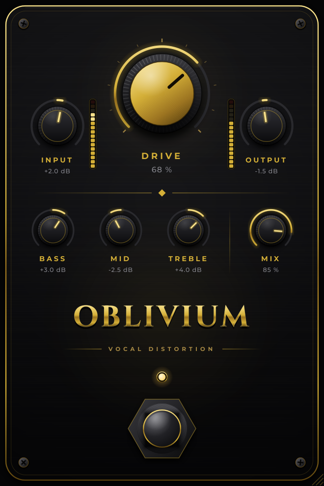

# Oblivium

Pedal de distorção vocal em formato VST3 (e VST2 opcional) para **Windows** e **Linux**, feito com [JUCE](https://juce.com).

<p align="center"></p>

## Controles

| Controle | Faixa | O que faz |
|---|---|---|
| **Input** | -24 a +24 dB | Ganho antes do clipper. Mais input = mais saturação. |
| **Drive** | 0 a 100 % | Intensidade da distorção (até +40 dB no clipper). O volume é compensado automaticamente, então o knob muda mais o caráter do que o volume. |
| **Bass** | ±12 dB | Shelf de graves em 150 Hz. |
| **Mid** | ±12 dB | Peak de médios em 1 kHz. |
| **Treble** | ±12 dB | Shelf de agudos em 4,5 kHz. |
| **Mix** | 0 a 100 % | Mistura com o sinal limpo (distorção paralela, ótima para manter a inteligibilidade da voz). |
| **Output** | -24 a +24 dB | Volume final. |
| **Footswitch** | on / bypass | Liga e desliga o efeito com crossfade, sem clique. O LED acompanha o sinal enquanto o efeito está ligado. Também é o bypass que o DAW enxerga. |

Ao lado de **Input** e **Output** há medidores de nível de pico (-45 a 0 dBFS, 3 dB por segmento), com retenção de pico. O de entrada mostra o sinal *depois* do ganho de Input, ou seja, o que chega no clipper. O de saída mostra o sinal final. O segmento vermelho no topo acende quando o sinal passa de 0 dBFS e fica aceso por 2 s; clique no medidor para zerá-lo.

Duplo clique num knob volta ao valor padrão. Arrastar segurando Shift faz ajuste fino. A janela pode ser redimensionada pelo canto inferior direito (75 % a 175 %).

## Cadeia de sinal

```
Input ─► HPF 90 Hz ─► presença +4 dB @ 1,8 kHz ─► [oversampling 4x ─► saturação tanh assimétrica] ─► DC block ─► LPF 11 kHz
      ─► Bass / Mid / Treble ─► Mix (dry alinhado pela latência) ─► Output ─► Bypass
```

- O **oversampling 4x** (FIR de fase linear) evita aliasing no agudo da voz. Ele adiciona ~61 amostras de latência, informadas ao DAW para compensação automática.
- A **assimetria** do clipper gera harmônicos pares, que deixam a distorção mais quente e menos "fizz".
- O sinal limpo usado no **Mix** e no **Bypass** é atrasado exatamente pela latência, então não há cancelamento de fase.

## Compilando

Requisitos: **CMake 3.22+** e um compilador C++17. O JUCE (8.0.15) é baixado automaticamente na primeira configuração.

### Windows

Visual Studio 2022 com a carga de trabalho "Desenvolvimento para desktop com C++".

```powershell
cmake -B build
cmake --build build --config Release
```

Copie `build\Oblivium_artefacts\Release\VST3\Oblivium.vst3` para `C:\Program Files\Common Files\VST3\`.

### Linux

```bash
sudo apt install build-essential cmake git libasound2-dev libfreetype-dev libfontconfig1-dev \
  libx11-dev libxcomposite-dev libxcursor-dev libxext-dev libxinerama-dev libxrandr-dev \
  libxrender-dev libgl1-mesa-dev

cmake -B build -DCMAKE_BUILD_TYPE=Release
cmake --build build -j$(nproc)
cp -r build/Oblivium_artefacts/Release/VST3/Oblivium.vst3 ~/.vst3/
```

Também é gerado um executável **Standalone** (`build/Oblivium_artefacts/Release/Standalone/`) para usar sem DAW. No Standalone, o seletor no topo do pedal escolhe o dispositivo de entrada de áudio (os demais ajustes ficam em *Options → Audio/MIDI Settings*). Por padrão o JUCE começa com a entrada **mutada** para evitar microfonia: desmarque *Mute audio input* em *Options* (de preferência usando fones).

> **Linux:** feche o Reaper (ou outro programa que esteja usando a interface em modo ALSA exclusivo) antes de abrir o Standalone. Com o microfone ocupado, a captura do dispositivo padrão do PipeWire trava e o JUCE 8.0.15 pode fechar o app ao trocar de dispositivo.

### Opções do CMake

| Opção | Padrão | Uso |
|---|---|---|
| `OBLIVIUM_JUCE_DIR` | vazio | Usar um checkout local do JUCE em vez de baixar. |
| `OBLIVIUM_JUCE_TAG` | `8.0.15` | Versão do JUCE a baixar. |
| `OBLIVIUM_VST2_SDK_DIR` | vazio | Caminho do SDK legado do VST2. Quando definido, gera também o plugin VST2. |
| `OBLIVIUM_COPY_AFTER_BUILD` | `OFF` | Copia o plugin para a pasta de plugins do sistema após compilar. |

**Sobre o VST2:** a Steinberg não distribui mais o SDK do VST2, e o JUCE não pode compilar esse formato sem ele. Se você tiver o SDK (de uma licença antiga), passe `-DOBLIVIUM_VST2_SDK_DIR=/caminho/do/sdk`. Praticamente todos os DAWs atuais (Reaper, Ableton, FL Studio, Cubase, Bitwig, Studio One) carregam VST3.

## CI

O workflow `.github/workflows/build.yml` compila Linux e Windows a cada push e publica os `.vst3` como artefatos da execução.

## Licenças

- Código do Oblivium: MIT (ver `LICENSE`).
- Fontes Cinzel e Montserrat: SIL Open Font License (ver `Resources/Fonts/`).
- JUCE: AGPLv3 ou licença comercial do JUCE. Para distribuir binários fechados é preciso uma licença do JUCE (há um plano gratuito para receita anual pequena).
